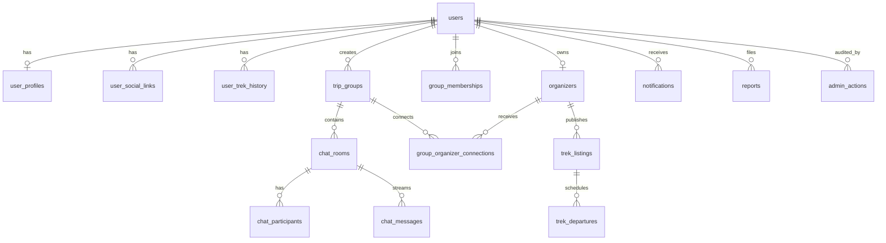

# The Great Trek Lores — Trekking Community Platform

A lightweight, community-oriented social platform designed to bridge the communication gap between independent trekkers seeking companions and local trekking organizers offering departure packages.

Built specifically as a **zero-cost, permanently live portfolio MVP**.

---

## 🏔️ Core Highlights

- **Solo Trekker Matching:** Trekkers create temporary companion groups with target dates and member limits.
- **Organizer Listings & Departures:** Small trekking companies publish packages (e.g., *Kedarkantha*, *Pangarchulla*) split into concrete scheduled batches.
- **Smart Date Matching:** Instant query matching groups' preferred dates with scheduled departure batches.
- **Dual-Room Chat Architecture:**
  - `MAIN_GROUP` room: Private room for accepted trekkers only (organizers strictly excluded).
  - `ORGANIZER_DISCUSSION` room: Private 1-on-1 negotiation room created per accepted connection.
- **Zero-Cost Permanent Hosting:** Designed to run 24/7 indefinitely on verified free tiers with zero monthly bills.

---

## 🛠️ Technology Stack

| Layer | Technology | Hosting / Service (Free Tier) |
| :--- | :--- | :--- |
| **Frontend** | React 18, TypeScript, Tailwind CSS, Axios, StompJS | **Vercel** (Global CDN, 0 cold starts) |
| **Backend** | Java 21, Spring Boot 3, Spring Data JPA, Spring Security | **Render** or **Koyeb** (512MB RAM container) |
| **Database** | PostgreSQL 16 | **Neon.tech** (Serverless, permanent 0.5 GB free) |
| **Real-time** | Spring WebSocket + STOMP | Embedded in Spring Boot |
| **Media Storage** | Cloudinary API | **Cloudinary** (25 GB permanent free tier) |
| **Docs & Testing** | Swagger / OpenAPI 3, JUnit 5, Mockito | Built into application |

---

## 📚 Project Documentation

- [IMPLEMENTATION_PLAN.md](file:///d:/PROJECTS/THE_GREAT_TREK_LORES/IMPLEMENTATION_PLAN.md): Phased roadmap, task checklist, and live progress dashboard.
- [trekking_community_platform_plan (1).md](file:///d:/PROJECTS/THE_GREAT_TREK_LORES/trekking_community_platform_plan%20(1).md): Original full system specification and requirements.
- [trekking_community_database_plan.md](file:///d:/PROJECTS/THE_GREAT_TREK_LORES/trekking_community_database_plan.md): Complete schema plan (16 MVP tables + 4 deferred).
- [API_SPECIFICATION.md](file:///d:/PROJECTS/THE_GREAT_TREK_LORES/API_SPECIFICATION.md): REST endpoints, WebSocket STOMP topics, and payload schemas.
- [ARCHITECTURE_AND_SECURITY.md](file:///d:/PROJECTS/THE_GREAT_TREK_LORES/ARCHITECTURE_AND_SECURITY.md): Security rules, chat isolation, and 512MB JVM tuning.

---

## 🚀 Quick Start (Local Development)

### Prerequisites
- Java 21 JDK
- Node.js (v18+)
- Docker & Docker Compose
- Maven

### 1. Clone & Setup Environment
```bash
git clone https://github.com/your-username/the-great-trek-lores.git
cd the-great-trek-lores
```

### 2. Start Local Database
```bash
docker compose up -d postgres
```

### 3. Run Backend (Spring Boot)
```bash
cd backend
./mvnw spring-boot:run
```
*Backend runs at:* `http://localhost:8080`  
*Swagger Documentation:* `http://localhost:8080/swagger-ui.html`

### 4. Run Frontend (React + Vite)
```bash
cd frontend
npm install
npm run dev
```
*Frontend runs at:* `http://localhost:5173`

---

## ☁️ Zero-Cost Cloud Deployment Blueprint

```
       [ Client Browser ]
               │
      ┌────────┴────────┐
      ▼                 ▼
[ Vercel CDN ]    [ Cloudinary ]
(React Frontend)   (Images & Avatars)
      │
      ▼ HTTPS / WSS
[ Render / Koyeb Web Service ]
(Spring Boot 3 - Optimized to 256MB Heap)
      │
      ▼ SSL (PgBouncer)
[ Neon.tech PostgreSQL ]
(Serverless Free Tier)
```

1. **Database (Neon Serverless PostgreSQL):**
   - Create a free database on [Neon.tech](https://neon.tech) (0.5 GB permanent storage, zero credit card required).
   - Copy your connection string into `SPRING_DATASOURCE_URL`:
     `jdbc:postgresql://<neon-endpoint>.neon.tech/neondb?sslmode=require`
   - Set `SPRING_DATASOURCE_USERNAME` and `SPRING_DATASOURCE_PASSWORD`.

2. **Backend (Render Free Web Service):**
   - Deploy as a Docker Web Service pointing to `backend/Dockerfile`.
   - Alternatively, apply the included Infrastructure-as-Code blueprint `render.yaml`.
   - The Dockerfile applies 512MB RAM flags:
     ```bash
     JAVA_OPTS="-XX:+UseSerialGC -Xmx256m -Xms128m -Xss512k -XX:MaxMetaspaceSize=128m -Djava.security.egd=file:/dev/./urandom"
     ```
   - Set environment variable `CORS_ALLOWED_ORIGINS=https://<your-vercel-app>.vercel.app`.

3. **Frontend (Vercel Global Edge Network):**
   - Import your repository into [Vercel](https://vercel.com) with root directory set to `frontend`.
   - Set Environment Variable:
     `VITE_API_BASE_URL=https://<your-render-backend-url>/api`
   - Deploy! `frontend/vercel.json` ensures full SPA routing fallback to `/index.html`.

4. **Media Storage (Cloudinary):**
   - Create a free account on [Cloudinary](https://cloudinary.com) and set `CLOUDINARY_CLOUD_NAME`, `CLOUDINARY_API_KEY`, and `CLOUDINARY_API_SECRET`.
   - If left empty, the application automatically uses mock photo URLs without crashing.

---

## 👥 Demo Personas (Pre-Seeded & 1-Click Login)

For instant recruiter review, click any demo login button inside the auth modal:
| Persona | Email | Password | Role | Pre-Seeded Context |
| :--- | :--- | :--- | :---: | :--- |
| **Solo Trekker** | `trekker@demo.com` | `password123` | `USER` | Leader of "Kedarkantha Solo Trekkers Cohort", verified trek history, unread notifications |
| **Companion** | `companion@demo.com` | `password123` | `USER` | Confirmed group member, active participant in group chat |
| **Organizer** | `organizer@demo.com` | `password123` | `ORGANIZER` | Founder of *Himalayan Escapes & Trails*, published Kedarkantha & Roopkund departures |
| **Platform Admin** | `admin@demo.com` | `password123` | `ADMIN` | Community safety manager with audit access to user reports and content moderation |

---

## 🏗️ 16-Table Schema Architecture



---

## 🔒 Security & Dual-Room Isolation Model

1. **Dual Chat Rooms:**
   - **`MAIN_GROUP` room:** Auto-provisioned for each trip group. Restricted strictly to accepted trekker companions. Organizers are completely prevented from joining or querying messages.
   - **`ORGANIZER_DISCUSSION` room:** Auto-provisioned when a matchmaking connection between a group and an organizer is `ACCEPTED`. Both group members and the organizer converse here to finalize package details.
2. **Contact Privacy:**
   - Social links and contact handles support three visibility tiers: `PRIVATE` (only owner), `GROUP_MEMBERS` (companions only), and `PUBLIC`.
3. **Zero Financial Gateway Liability:**
   - The platform finalizes connections through status confirmation (`CONFIRMED`), deliberately avoiding payment gateway compliance fees to keep the platform 100% free forever.
